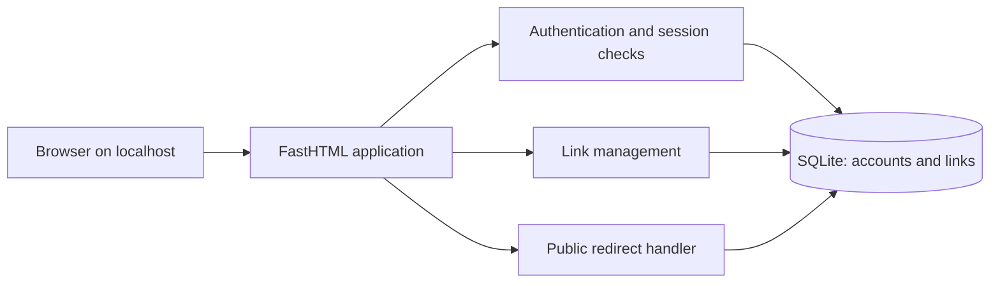

# Local URL Shortener

* **Author:** Not specified
* **Status:** Draft
* **Date:** 2026-08-05

## Overview

This design proposes a web application available only on the same machine through localhost. It stores accounts and short links in SQLite. Multiple people using the app can sign up with an email address and password, create and remove links they own, and share short URLs. Visitors do not need to sign in to follow a link from that machine. Destinations are limited to HTTP and HTTPS.

Account and link records must remain available after the application restarts. Password recovery, email verification, and rate limiting are not included in the first version. All runtime configuration is stored in a local `.env` file.

## The Problem

People using one machine need a way to create and manage short links without relying on an external shortening service. The application separates links by signed-in account, while allowing anyone using that machine to follow a shared short URL without an account.

The design is limited to account signup/sign-in, link creation and listing, removal, and localhost redirects. It does not address analytics, link editing, or access from other machines.

## Goals

* Allow a person to sign up and sign in with an email address and password.
* Store account and link data in SQLite so it survives application restarts.
* Allow a signed-in person to create and view their own short links.
* Allow a person to remove only links they own; destinations cannot be edited.
* Allow visitors using the same machine through localhost to follow short URLs without signing in.
* Accept only valid HTTP or HTTPS destination URLs.
* Return HTTP 404 with a not-found response for unknown or removed short URLs rather than redirecting them.
* Keep the app bound to localhost so only the same machine can reach it.

## Non-Goals

* Public-internet hosting or a distributed, multi-machine service.
* Password recovery or email verification.
* Rate limiting in the first version; basic throttling is a future enhancement.
* Editing destinations, custom aliases, expiration, click analytics, or other link features not requested.
* Detecting or handling failures at the destination website; those failures are left to the visitor's browser.
* A guarantee of unlimited storage, traffic, or availability.

## Open Questions

No product decisions remain open for the first version. Runtime settings are stored in `.env`. Sequential Base62 codes are accepted as guessable because links are public and the app is localhost-only.

## Critical User Journeys (CUJs)

### CUJ 1: Create and manage a short link

* **Given:** A person has signed up, can sign in, and is using the app on the same machine.
* **When:** They sign in, submit a valid HTTP/HTTPS destination, and later remove the link they own.
* **Then:** The app creates a shareable short URL, displays it in their link list, and after successful removal returns HTTP 404 for that URL. The removed code is never assigned to another link.

### CUJ 2: Follow a shared short URL

* **Given:** A visitor is using the same machine and has an active short URL.
* **When:** They open the URL without signing in.
* **Then:** The app returns a 302 redirect to the stored destination. Unknown and removed codes return HTTP 404 with a not-found response.

### CUJ 3: Keep accounts' links separate

* **Given:** Two people have separate accounts and links.
* **When:** One person views or tries to remove a link belonging to the other.
* **Then:** The app shows only the signed-in person's active links and refuses to remove a link owned by another account.

## Technical Plan (Architecture)

### Application shape

Build a server-rendered web application in Python with FastHTML. FastHTML route handlers render the account and link-management pages and handle form submissions. Run one application process on one machine, bound to `127.0.0.1` so it is reachable only from localhost. Use SQLite as the only database.

Separate the application into three responsibilities:

1. **Authentication and sessions:** Sign-up, sign-in, and sign-out; verify passwords and identify the signed-in account for protected requests.
2. **Link management:** Validate destinations, create short codes, list links for the signed-in owner, and remove links only when the owner matches the current account.
3. **Public redirect:** Resolve a short code without requiring a session and redirect to its stored HTTP/HTTPS destination. A missing code returns HTTP 404 with a not-found response and does not reveal database details.

These can be implemented as small modules or functions in one app; separate network services are not needed.

### Data and persistence

Store accounts and links in SQLite. The account table has a unique normalized email field and a hashed-password field. Each link has a generated ID, a destination URL, and its owner's account ID; encode the ID in Base62 to form the short code. The ID source must not reuse values after link removal, so an old short URL can never point to a new link; the implementation may choose the SQLite mechanism. Account and link data remain available after the app restarts. Removing a link makes its short URL return HTTP 404. Public access to a short URL does not grant permission to manage its link; only its owner can remove it.

Load configuration from the project-root `.env`, including the session-signing secret, database path, localhost bind address, port, and `APP_BASE_URL`. Fail at startup with a clear message if a required value is missing or invalid. Do not store plain-text passwords. Use a signed session with no application-defined expiry; signing out clears the current session. Mark the session cookie `HttpOnly` and `SameSite=Lax`; HTTPS-only cookie transport is not used for this localhost HTTP version. Protect state-changing forms with an unpredictable session-bound CSRF token that the app validates on each request.

### Request flows

- **Sign-up and sign-in:** People create accounts with an email address and password, then sign in. Trim surrounding whitespace and lowercase email addresses before storing and comparing them; reject malformed addresses. The normalized email column is unique; signup with a duplicate address is rejected with an “already registered” message, an accepted account-enumeration risk for this trusted, localhost-only app. Invalid sign-in uses a generic error. Password recovery and email verification are not included.
- **Password rule:** Apply the supplied regex below as the complete password rule. It requires 12–30 characters, including uppercase and lowercase letters, a digit, and at least one of the punctuation characters in the expression. Do not add separate ASCII-only or whitespace restrictions beyond the regex's own matching behavior.

```regex
^(?=.*[A-Z])(?=.*[a-z])(?=.*\d)(?=.*[!@#$%^&*()_+=\-[\]{}|;:',.<>/?~`]).{12,30}$
```

- **Create and manage links:** A signed-in person can create links to absolute HTTP or HTTPS URLs with a valid host. Reject malformed URLs, credentials, and control characters with a clear validation error. A signed-in person can view and remove their own links. The app encodes each generated link ID as Base62. Anyone on the same machine can follow a link without signing in; only its owner can remove it.
- **Follow a link:** The app looks up the short code and returns a 302 redirect to the destination. Unknown and removed short URLs return HTTP 404 with a not-found response; destination failures are left to the browser.

The app uses `APP_BASE_URL` from `.env` to display each shareable short URL.

### Request path



Authentication is required for account and link-management pages. The public redirect handler does not require authentication. All paths use the same SQLite database and process.

### Relevant points from the ByteByteGo design

The course describes two core operations: create a short URL from a long URL, then look up the destination when a visitor requests the short URL. It recommends a relational database mapping, rather than keeping all mappings only in memory. This app uses SQLite for that mapping.

The course compares hash-based codes, which require collision handling, with Base62-encoded database IDs generated from unique IDs. It notes that incrementing IDs make nearby codes easy to guess. This design adopts the Base62 ID approach and accepts that trade-off because links are public on the local machine. The course assumes short URLs cannot be deleted or updated; this app allows removal, so the separate requirement that deleted IDs are never reused is specific to this design. The course also compares HTTP 301 and 302 redirects. This design uses 302 so the browser returns to the app on later visits and can observe link removal. The course's large-service estimates (100 million links per day, about 1,160 writes and 11,600 reads per second, and 36.5 TB over ten years) do not apply here; distributed infrastructure is out of scope.

### Network boundary and operational limits

Bind the app to `127.0.0.1` (localhost). This blocks access from other machines, but it does not isolate accounts from other users or processes on the same machine. This design is for a trusted, single-machine environment, not a shared untrusted host. Sessions have no application-defined expiry, so users must sign out when finished, especially on a shared browser. Put all configuration in the project-root `.env` file and keep that file out of version control. SQLite and one application process are sufficient for this scope. Automated backup and recovery are out of scope; manually copy the database while the app is stopped. To restore, replace the database file while the app is stopped, then run SQLite's integrity check before restarting. No recovery-time or data-loss guarantee is provided. Rate limiting is deferred; repeated login attempts are an accepted first-version risk.

### Decisions finalized for implementation

- The app runs on one machine, binds to localhost, uses SQLite, and reads all runtime configuration from `.env`.
- Multiple people can sign up with unique email addresses and passwords. Passwords follow the rule above and are stored as hashes. Sessions have no application-defined expiry. Duplicate-email disclosure and unthrottled login attempts are accepted first-version risks for a trusted local machine.
- Signed-in users can create, view, and remove their own links. Short URLs are public to anyone using the same machine; public access does not allow managing another user's link.
- Only absolute HTTP and HTTPS URLs with valid hosts are accepted. Unknown or removed links return HTTP 404 with a not-found response.
- Data persists across restarts. Manual backups are the operator's responsibility; automated backup and recovery, email verification, and rate limiting are out of scope.

## Alternatives Considered

### Use an existing URL-shortening service

* **Pros:** Avoids building and maintaining account management, storage, and redirect handling.
* **Cons:** The service would be external to the local machine and may not meet the goal of managing links locally.
* **Reason for Rejection:** The stated use is a locally run, multi-account application. If local ownership is not important, an existing service would be simpler and should be reconsidered.

### Use DuckDB or combine DuckDB with SQLite

* **Pros:** DuckDB supports analytical queries; using two stores might serve different workloads.
* **Cons:** These are separate database engines. Adding DuckDB or maintaining two databases increases setup, data-consistency, and operational work without a stated analytics need.
* **Reason for Rejection:** The first version needs account and link creation, listing, deletion, and code lookup. SQLite is sufficient for those transactional operations on one machine.

### Use a hosted, multi-machine architecture

* **Pros:** Could support users outside the local machine and reduce dependence on one machine.
* **Cons:** Requires network access, remote storage, additional operational work, and a broader security and availability design.
* **Reason for Rejection:** Access from other machines and multi-machine operation are explicitly outside the current scope. Revisit only if the audience or availability needs change.

### Use a different Python web framework

* **Pros:** Flask or Django would also support server-rendered web applications; Django includes a more complete account-management framework.
* **Cons:** Changing frameworks would diverge from the requested Python and FastHTML direction. Django also brings a broader framework surface than the current app requires.
* **Reason for Rejection:** FastHTML fits the requested small, server-rendered Python app and provides route handling and test support without requiring an API-first design. Unlike Django's built-in account features, FastHTML leaves account policy, password handling, and authorization to this application; that work is part of the design. SQLite access can use Python's standard `sqlite3` module, so an additional database layer is not required.

## Non-Functional Requirements

* **Security and privacy:** Store password hashes, not plain-text passwords. Use sessions without an application-defined expiry and protect state-changing forms with a validated CSRF token. Enforce owner-only link management. Accept only absolute HTTP/HTTPS URLs with a valid host and reject credentials or control characters. Localhost blocks remote machines but does not isolate users or processes on the host.
* **Persistence:** Keep accounts and active links in SQLite across restarts. Removing a link must make its short URL unavailable.
* **Availability and operations:** Bind only to localhost. The app runs on one trusted machine; no unlimited traffic, storage, or availability is promised. Rate limiting and automated backups are not included. Manual backups require stopping the app; no recovery-time or data-loss guarantee is promised.
* **Compatibility:** There is no existing application data to migrate. Preserve user data when the database schema changes in future versions.

## Additional Resources

* [Concepts brief](./concepts_brief.md)
* [ByteByteGo URL shortener system-design course](https://bytebytego.com/courses/system-design-interview/design-a-url-shortener)
* [FastHTML concise guide](https://www.fastht.ml/docs/ref/concise_guide.html)
* [FastHTML core reference](https://www.fastht.ml/docs/api/core.html.md)

## Future Improvements

* Add basic throttling for login and link-creation requests.
* Add automated backup and restore support.
* Add support for access from other machines only if that becomes a requirement; secure transport would then need to be addressed.
* Add password recovery and email verification if the app's account needs change.
* Use a generic signup response to avoid revealing whether an email address already has an account.

## Detailed Implementation Plan

### Project root

Create the new application at `~/projects/url-shortener/`, separate from the notes workspace.

### Suggested folder structure

This is a suggested starting point, not a required file-by-file design. Keep or change the structure to fit FastHTML conventions and the simplest implementation that meets the requirements above. Put all runtime settings in the project-root `.env`; commit only the example template. Include `BIND_HOST=127.0.0.1`, `PORT=5001`, `APP_BASE_URL=http://localhost:5001`, `DATABASE_PATH=data/shortener.sqlite3`, and a clearly marked placeholder `SESSION_SECRET` in `.env.example`. `PORT=5001` and the matching `APP_BASE_URL` are example defaults, not product requirements; keep `BIND_HOST=127.0.0.1` (localhost).

```text
url-shortener/
├── app.py
├── auth.py
├── links.py
├── db.py
├── migrations/
├── tests/
├── requirements.txt
├── .env.example
├── .gitignore
└── README.md
```

The objective and user-visible behavior are defined in the earlier sections. Implementation should preserve those requirements while avoiding extra layers or features. Use FastHTML and SQLite; hash passwords, preserve owner-only management, validate HTTP/HTTPS destinations, persist data across restarts, read configuration from `.env`, and bind only to localhost. The exact module boundaries and test organization are implementation choices; the suggested tree is not mandatory.

### Minimal setup

Use Python 3.11 or newer. Record FastHTML, `python-dotenv` for loading `.env`, and `pytest` for tests in the suggested `requirements.txt`; pin versions compatible with the chosen Python version when implementing. In the project root, create and activate a virtual environment, install dependencies, copy `.env.example` to `.env`, and run the app and tests, for example:

```sh
python3 -m venv .venv
. .venv/bin/activate
python -m pip install -r requirements.txt
cp .env.example .env
```

Set the real private values in the root `.env`; never commit it. `SESSION_SECRET` in `.env.example` is only a placeholder. Generate a private value with `python -c 'import secrets; print(secrets.token_urlsafe(32))'` and place the output in `.env`. Keep `BIND_HOST=127.0.0.1`. `PORT=5001` and `APP_BASE_URL=http://localhost:5001` are convenient example defaults, not product requirements; if the port changes, set `APP_BASE_URL` to the matching local base URL. Start with `python app.py` and run automated tests with `python -m pytest`. Document these setup, run, and test commands in the suggested `README.md`.

### Incremental implementation outcomes

1. **Runnable foundation:** valid root `.env` starts the app, binds only to localhost, and invalid/missing required configuration fails clearly.
2. **Accounts and safety:** signup/sign-in/sign-out work with normalized unique email, the specified password rule and hashed passwords; session, cookie, and CSRF protections are exercised.
3. **Links and persistence:** owner-scoped create/list/removal and public redirects work; removed codes are not reused and data survives restart.

### Verification Plan

Automated tests must assert these outcomes (test locations and organization are implementation choices):

- Signup accepts a valid email/password, normalizes email, rejects malformed or duplicate email, enforces the supplied password regex, stores no plaintext password, and sign-in rejects invalid credentials generically.
- A user can remove their own link; another account cannot remove it and the link remains active.
- State-changing requests without a valid session-bound CSRF token are rejected. Session signing is required; sign-out clears the session. Cookies are `HttpOnly` and `SameSite=Lax`, with no application-defined expiry and no `Secure` requirement for localhost HTTP.
- Malformed, relative, non-HTTP(S), hostless, credential-bearing, and control-character destinations are rejected with a validation error.
- A valid short code returns HTTP 302 to its stored destination; unknown and removed codes return HTTP 404 with a not-found response. A deleted code is never assigned again.
- Accounts and links remain available after restarting the app.
- Missing/invalid required configuration prevents startup with a clear error; the server listens on `127.0.0.1`, not a network interface.

Keep manual backups of the SQLite database; automated backups, account recovery, email verification, rate limiting, and access from other machines remain future work.

